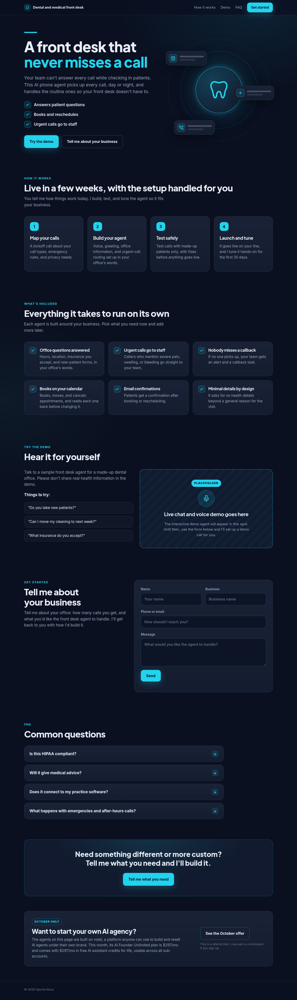

# AI Agent Landing Pages

A generator for fast, responsive landing pages for six AI phone/chat agent offers (dental front desk, restaurant phone agent, real-estate lead caller, appointment reminders, review requests, custom agent). One Python content file drives every page; includes a lead form and automated desktop/mobile screenshots.

**Tech stack:** Python static-site build, hand-written HTML/CSS, Playwright screenshots

> **How this was built:** built fast with AI coding tools (vibe coding), then reviewed, tested, and documented by me. Demo data only: all names, numbers, and businesses are fictional.

## Screenshots

Built by DeAli Dillard ([Aporia Nous](https://github.com/Aporia-Nous)). Contact: demo@aporianous.com. MIT licensed.

---

# Demo landing pages (local drafts, not published)

Six single-page landing pages, one per catalog offer. Nothing here has been uploaded anywhere.

| Page | File |
|---|---|
| Restaurant phone agent | `restaurant-phone-agent/index.html` |
| Dental / medical front desk | `dental-front-desk/index.html` |
| Real estate lead caller | `real-estate-lead-caller/index.html` |
| Appointment reminders / no-shows | `appointment-reminders/index.html` |
| Review requests | `review-requests/index.html` |
| Custom AI agent (voice or non-voice) | `custom-ai-agent/index.html` |

- Copy lives in `content.py`; layout and styles in `build.py`. Rebuild all six with `python3 build.py`.
- Screenshots: `/workspace/upwork-portfolio/.venv/bin/python shoot.py` writes `screenshots/<slug>-desktop.png` (1280 wide, full page) and `screenshots/<slug>-mobile.png` (390 CSS px wide at 2x, so the PNG is 780 px wide).
- Each page loads `shared/lead-form.js`, so the `shared/` folder must be uploaded next to the page folders (pages reference `../shared/lead-form.js`).

## Gated through reps (Oct 9, 2026)

Ali isn't on Votel's white-label plan yet, so visitors must never reach Votel directly.

- The Votel referral banner ("Want to start your own AI agency? … Explore votel") and `shared/promo.js` are removed. The builds assert that no page contains "votel", the referral placeholder, or promo.js.
- Every "get started / try it / book / quote" button goes to `#contact`, a single lead form (name, business, phone, email, industry, best time, optional message). The form is defined once in `leadform.py` and used by these pages and the hosted home page (`/workspace/votel-demos/hosting/build_home.py`).
- The form posts to the rep portal's lead intake, `POST /api/lead-intake` (`/workspace/rep-program/portal`), which saves the lead and auto-assigns it to a rep, or to Ali. The URL comes from `LEAD_INTAKE_URL` (default `http://localhost:3100/api/lead-intake` for the local preview). Before publishing: deploy the portal, then rebuild with `LEAD_INTAKE_URL=https://<portal>/api/lead-intake python3 build.py`, then re-run `make_site.py` and `build_home.py`.
- Launch offer shown: "50% off setup for our first few clients" (hero badge + a card next to the form). `lead-form.js` asks the portal (`GET /api/lead-intake`) whether the launch promo still has spots and hides the offer if not.
- Works without JavaScript too: a plain form post is redirected back to the page with `?lead=thanks#contact`.
- Still outside the source: when hosted on Votel's site builder, Votel injects `app.votel.ai/embeds/visitor-id.js` into every page. That's a tracker, not a link, but it's Votel's. Ali turns it off in the website builder's Custom code setting (dashboard only).
